<div align="center">

# 🛡️ Azure Cloud Security, Governance & SIEM Monitoring Lab

### End-to-End Defense-in-Depth Architecture with Microsoft Sentinel, Log Analytics (KQL), Azure Policy & RBAC

[](https://azure.microsoft.com/)
[](https://learn.microsoft.com/en-us/azure/sentinel/)
[](https://learn.microsoft.com/en-us/azure/data-explorer/kusto/query/)
[](https://learn.microsoft.com/en-us/azure/role-based-access-control/)
[](https://learn.microsoft.com/en-us/azure/governance/policy/)
[](https://learn.microsoft.com/en-us/credentials/certifications/azure-fundamentals/)

<p align="center">
  <strong>A hands-on Cloud Security & SecOps engineering project demonstrating enterprise-grade network hardening, least-privilege IAM, automated policy guardrails, centralized telemetry ingestion, and KQL threat hunting in Microsoft Azure.</strong>
</p>

[Architecture](#-cloud-architecture--topology) •
[Recruiter Highlights](#-recruiter--hiring-manager-quick-scan) •
[Defense-in-Depth Matrix](#-defense-in-depth-security-matrix) •
[Implementation Walkthrough](#-step-by-step-engineering-walkthrough) •
[KQL Threat Hunting](#-security-investigation--kql-hunting-queries) •
[FinOps & Cost Control](#-finops--cloud-cost-management)

</div>

---

## 🎯 Recruiter & Hiring Manager Quick-Scan

> **Why this project matters:** Rather than deploying isolated cloud resources with default settings, this lab implements a **complete security and governance lifecycle**—from network perimeter hardening and identity scoping to proactive compliance enforcement and SIEM telemetry analysis.

| Core Competency | Practical Implementation in This Lab | Target Role Alignment |
| :--- | :--- | :--- |
| **Network Security & Perimeter Hardening** | Segmented Virtual Network (`SecureLabVNet`) protected by custom **Network Security Group (`SecureLabNSG`)** priority rules restricting management access. | Cloud Security Engineer / Network Admin |
| **Identity & Access Management (Zero Trust)** | Granular **Azure RBAC** scoping: separated Subscription/RG-level `Owner` privileges from resource-scoped `Virtual Machine Contributor` permissions on `VM1`. | IAM Analyst / Cloud Administrator |
| **Cloud Governance & Compliance Guardrails** | Enforced built-in **Azure Policy** definitions (`Allowed virtual machine size SKUs` & region restrictions) at the `SecureLabRG` scope to block non-compliant deployments pre-provisioning. | Cloud Governance / FinOps / Platform Engineer |
| **Compute Hardening & Availability** | Provisioned **Gen2 Trusted Launch** Windows Server 2022 Datacenter Azure Edition Hotpatch VMs deployed into **Availability Zone 1** (`East US`). | Systems Engineer / Infrastructure Engineer |
| **SIEM Onboarding & Telemetry Engineering** | Configured **Azure Monitor Diagnostic Settings (`vm1d`)** streaming `audit`, `allLogs`, and `AllMetrics` into **Log Analytics (`SecureLabLA`)** and onboarded **Microsoft Sentinel**. | SOC Analyst (Tier 1/2) / SecOps Engineer |
| **Threat Hunting & Log Analysis (KQL)** | Authored and executed **Kusto Query Language (KQL)** queries across `SecurityEvent`, `AzureActivity`, and `Heartbeat` tables to audit administrative actions and remote access. | Detection Engineer / Security Analyst |

---

## 🏗️ Cloud Architecture & Topology

### Mermaid System Architecture Diagram

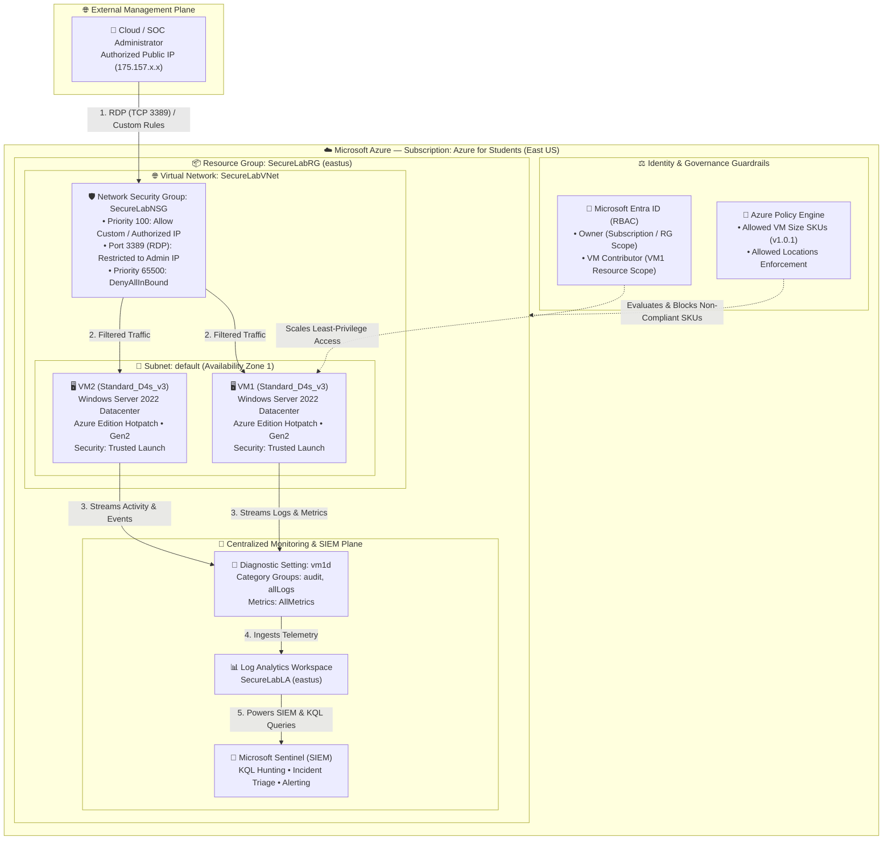

### Deployed Resource Inventory

| Resource Name | Azure Service / Type | Region / Zone | Configuration & Specifications | Security & Operational Role |
| :--- | :--- | :--- | :--- | :--- |
| **`SecureLabRG`** | Resource Group | `East US` | Logical lifecycle container | Centralizes RBAC inheritance, policy scoping, and atomic cost cleanup |
| **`SecureLabVNet`** | Virtual Network | `East US` | Isolated private address space + `default` subnet | Provides network segmentation for compute workloads |
| **`SecureLabNSG`** | Network Security Group | `East US` | Stateful 5-tuple packet filtering (`Priority 100` to `65500`) | Restricts inbound management traffic (`RDP 3389` / custom ports) to authorized source IP |
| **`VM1`** | Virtual Machine | `East US` (Zone 1) | `Standard_D4s_v3` (4 vCPUs, 16 GiB RAM), Win Server 2022 Hotpatch Gen2, Trusted Launch | Primary monitored workload; scoped for granular `Virtual Machine Contributor` RBAC & `vm1d` diagnostics |
| **`VM2`** | Virtual Machine | `East US` (Zone 1) | `Standard_D4s_v3` (4 vCPUs, 16 GiB RAM), Win Server 2022 Hotpatch Gen2, Trusted Launch | Secondary workload validating multi-host VNet isolation and governance policies |
| **`SecureLabLA`** | Log Analytics Workspace | `East US` | Azure Monitor centralized log store | Aggregates platform logs, `audit` trails, `allLogs`, and `AllMetrics` from compute & control plane |
| **Microsoft Sentinel** | Cloud-Native SIEM | `East US` | Attached to `SecureLabLA` | Enables security analytics, threat hunting via KQL, and incident investigation |

---

## 🛡️ Defense-in-Depth Security Matrix

This lab operationalizes Microsoft's **Defense-in-Depth** posture across six distinct cloud layers:

1. **Identity & Access Layer (Microsoft Entra ID & RBAC)**
   - Enforced the **Principle of Least Privilege (PoLP)** by assigning `Virtual Machine Contributor` strictly at the `VM1` resource scope (`Scope: This resource`) rather than broad subscription-wide rights.
   - Prevented unauthorized lateral movement or network reconfiguration (a `Virtual Machine Contributor` can manage the VM power/OS state but cannot modify the Virtual Network or NSG rules).
2. **Governance & Policy Layer (Azure Policy)**
   - Assigned the built-in **`Allowed virtual machine size SKUs`** (`v1.0.1`) policy definition to `SecureLabRG`.
   - Verified real-time admission control in the Azure Resource Manager (ARM) deployment pipeline—automatically greying out and blocking unapproved VM SKUs before resources can be provisioned.
3. **Perimeter & Network Layer (`SecureLabNSG` & `SecureLabVNet`)**
   - Evaluated default NSG rules (`AllowVnetInBound` [65000], `AllowAzureLoadBalancerInBound` [65001], `DenyAllInBound` [65500]) and injected high-priority custom allow rules (`Priority 100`) and source-IP-restricted RDP rules (`TCP 3389`).
4. **Compute & Host Layer (Trusted Launch Gen2 VMs)**
   - Deployed **Windows Server 2022 Datacenter: Azure Edition Hotpatch (x64 Gen2)** with **Trusted Launch** enabled, providing Secure Boot and vTPM attestation against bootkits and rootkits.
5. **Visibility & SecOps Layer (Azure Monitor + Microsoft Sentinel)**
   - Configured diagnostic pipeline (`vm1d`) capturing `audit` and `allLogs` category groups alongside `AllMetrics` into `SecureLabLA`, eliminating blind spots across control-plane and data-plane operations.
6. **FinOps & Cost Governance Layer**
   - Combined preventative SKU restrictions (Azure Policy) with operational hygiene (VM deallocation and single-RG atomic teardown) to maintain strict budget compliance.

---

## 🔧 Step-by-Step Engineering Walkthrough

### 1. Environment Initialization & Resource Group Provisioning
Authenticated into the Azure Portal under the `Azure for Students` subscription and provisioned a dedicated resource group (`SecureLabRG`) in the **`(US) East US`** region to encapsulate all lab infrastructure, access controls, and billing boundaries.

| Azure Portal Onboarding | Creating `SecureLabRG` in East US |
| :---: | :---: |
| 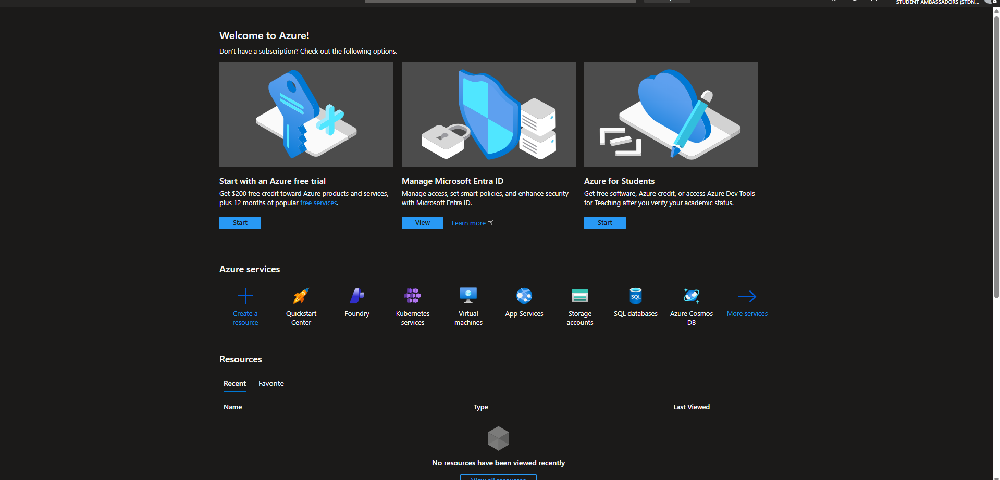 | 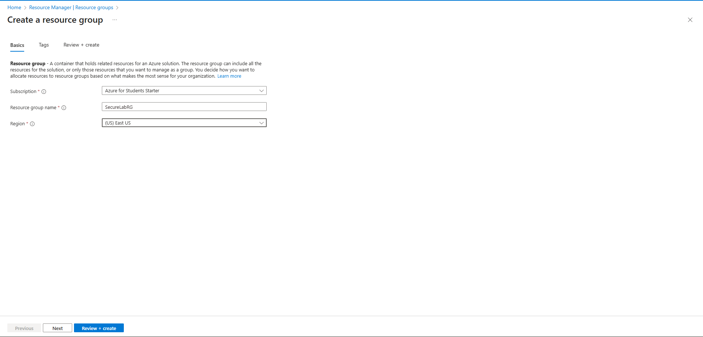 |

<details>
<summary>📸 <strong>View Provisioned Resource Group Verification (<code>RG created.png</code>)</strong></summary>
<br/>


</details>

---

### 2. Virtual Network Segmentation (`SecureLabVNet`)
Provisioned an isolated Virtual Network (`SecureLabVNet`) inside `SecureLabRG` (`East US`) with a `default` subnet to host the Windows Server workloads inside a controlled private IP space.

| Configuring `SecureLabVNet` | ARM Deployment Verification |
| :---: | :---: |
| 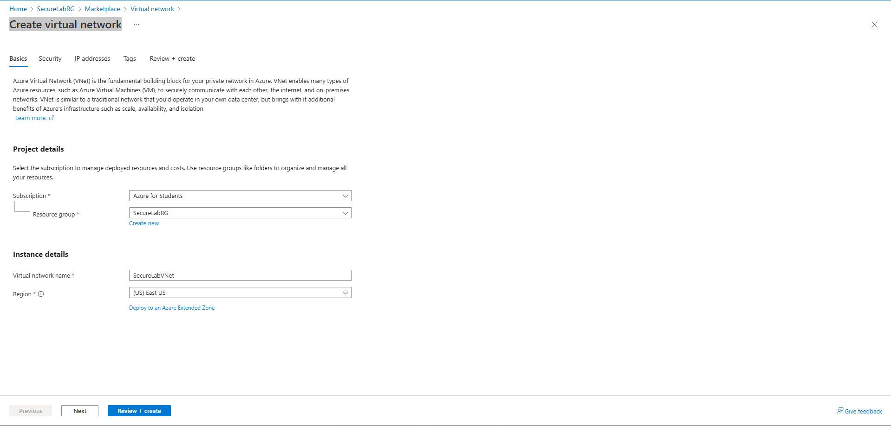 | 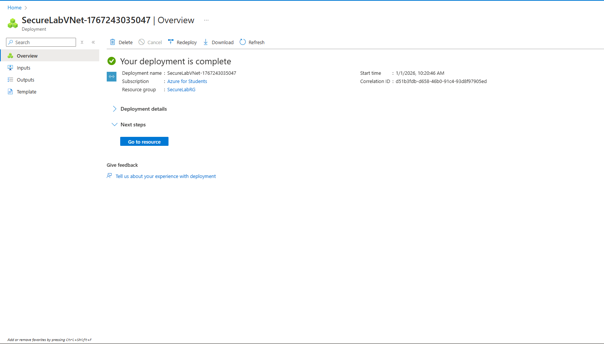 |

---

### 3. High-Availability Compute Provisioning (`VM1` & `VM2`)
Deployed two **Generation 2** Windows Server 2022 Datacenter (`Azure Edition Hotpatch`) Virtual Machines sized at **`Standard_D4s_v3`** (4 vCPUs, 16 GiB RAM) inside **Availability Zone 1** with **Trusted Launch** security enabled.

| Provisioning `VM1` (Zone 1, East US) | `VM1` Deployment Succeeded | Provisioning `VM2` (Zone 1, East US) |
| :---: | :---: | :---: |
| 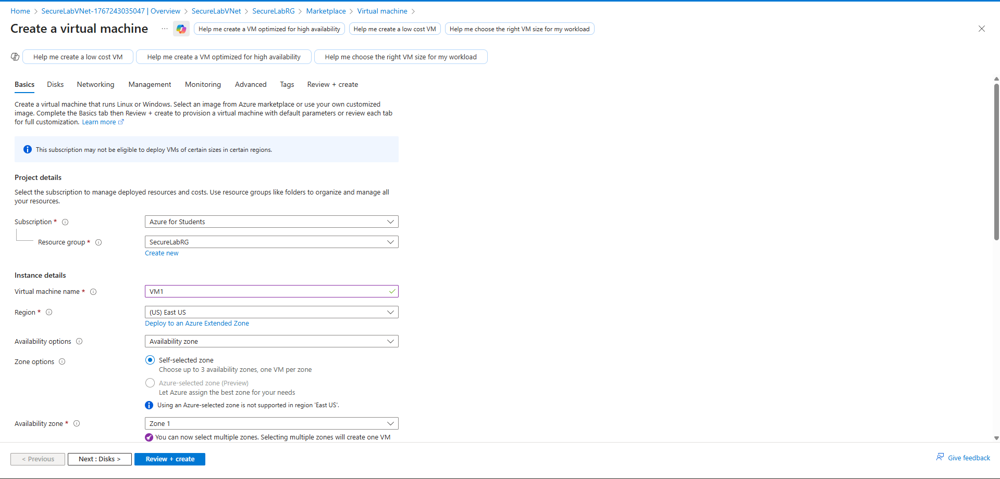 | 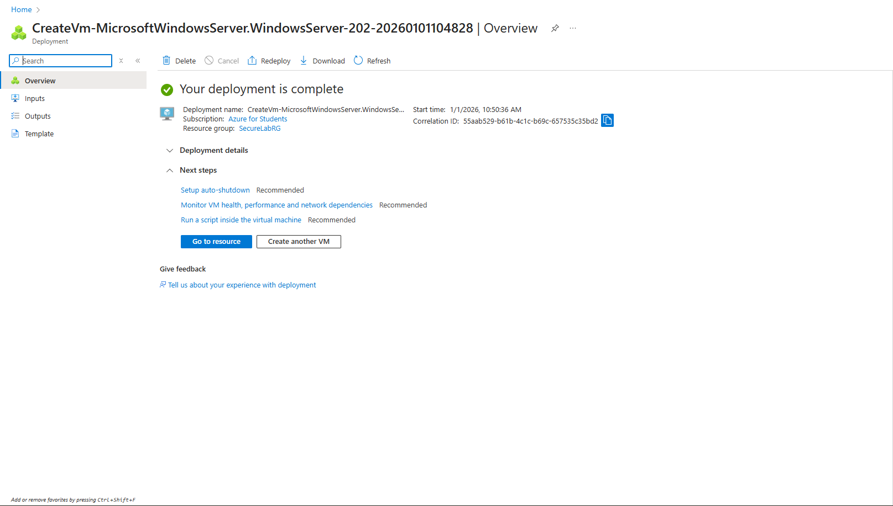 | 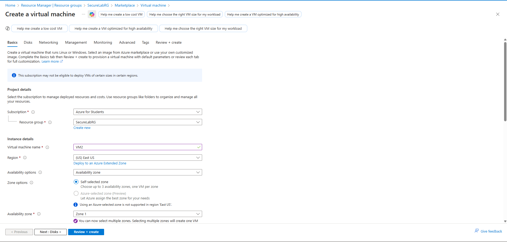 |

---

### 4. Network Security Hardening (`SecureLabNSG`)
Deployed `SecureLabNSG` in `East US` and configured custom inbound security rules (Priority `100`) overriding the default `DenyAllInBound` (`65500`) catch-all rule. Restricted Remote Desktop (`TCP 3389`) and management traffic exclusively to the administrator's public IP address, mitigating internet-wide brute-force and port-scanning attacks.

| Provisioning `SecureLabNSG` | Configuring Priority 100 Inbound Security Rule |
| :---: | :---: |
| 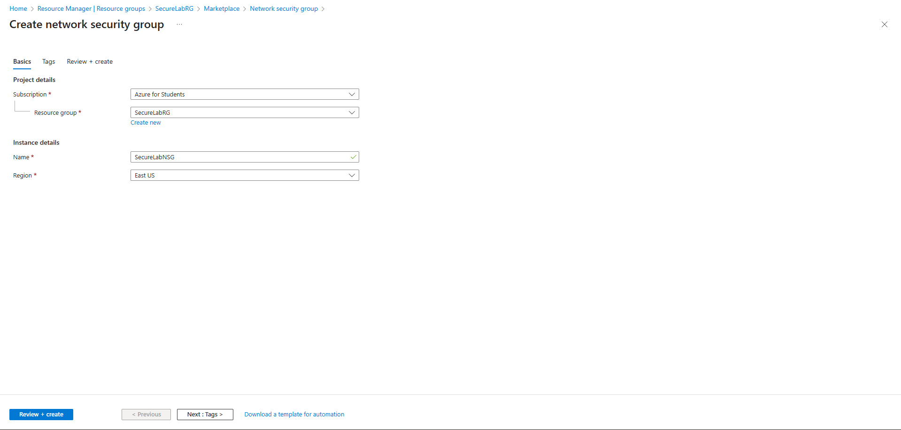 | 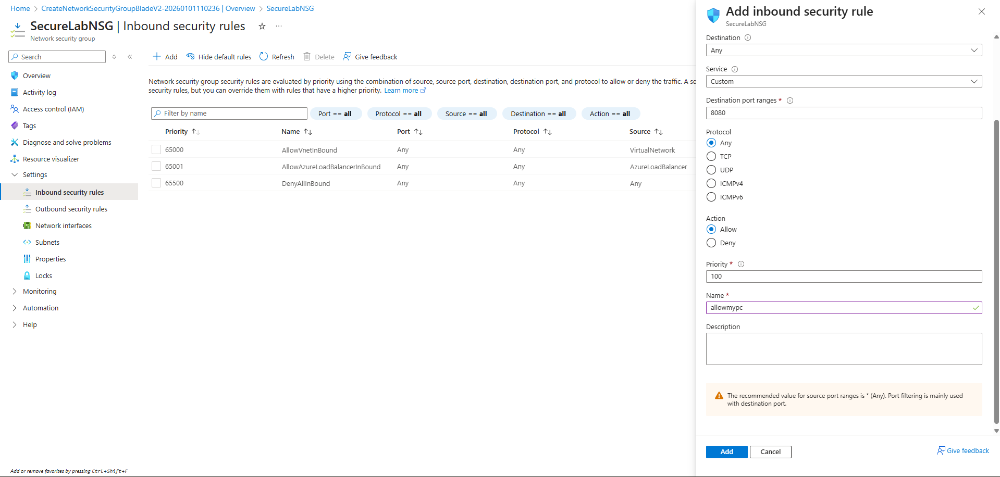 |

---

### 5. Validating Hardened Remote Access (Native RDP)
Verified end-to-end network reachability and NSG rule enforcement by connecting from the authorized Windows client IP (`175.157.141.15`) to `VM1`'s public IP (`20.55.26.32:3389`) via the built-in Windows Remote Desktop Connection client.

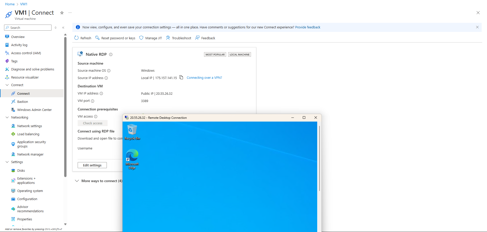

---

### 6. Least-Privilege Identity & Access Management (Azure RBAC)
Implemented granular role assignments in **Microsoft Entra ID / IAM** to separate administrative duties:
- **`Owner` (Subscription / RG Inherited Scope):** Full control over resource lifecycle and access delegation.
- **`Virtual Machine Contributor` (`VM1` Resource Scope):** Assigned specifically to user account `PEIRIS K H N A` on `VM1` (`Scope: This resource`), allowing VM operations (start, stop, restart, run scripts) without granting permissions to alter NSGs, VNets, or RBAC assignments.

| Assigning `Virtual Machine Contributor` on `VM1` | Verifying Multi-Scope RBAC Hierarchy |
| :---: | :---: |
| 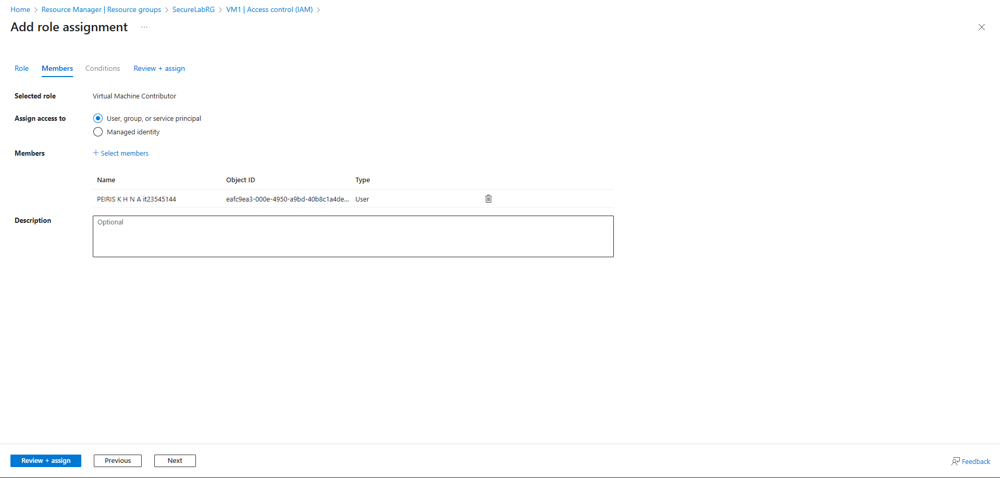 | 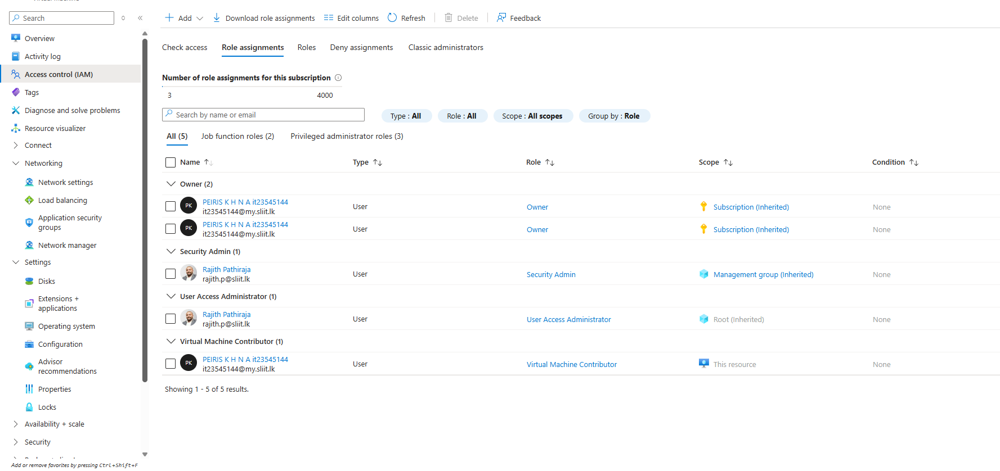 |

---

### 7. Automated Cloud Governance with Azure Policy
Configured and assigned built-in **Azure Policy** guardrails to prevent shadow IT and budget overruns:
1. Located the built-in **`Allowed virtual machine size SKUs`** (`v1.0.1`, Compute) policy definition.
2. Scoped the assignment directly to `Azure for Students` / `SecureLabRG` with **Policy enforcement: `Enabled`**.
3. Restricted allowed VM SKUs to an approved list of 11 SKUs (`Standard_D1_v2` through `Standard_D15i_v2`) alongside regional constraints.
4. **Compliance Validation:** Attempted to create a new VM in `SecureLabRG` and verified that Azure Policy actively intercepted the sizing blade: *"Item(s) availability based on policy assignment(s) for the selected scope: Allowed virtual machine size SKUs"*.

| 1. Selecting Built-In Policy Definition | 2. Scoping Policy to `SecureLabRG` |
| :---: | :---: |
| 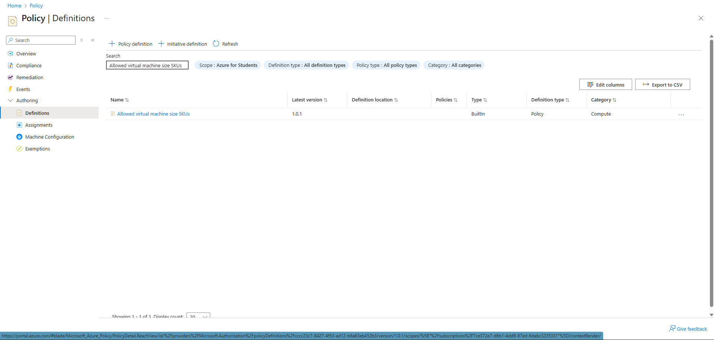 | 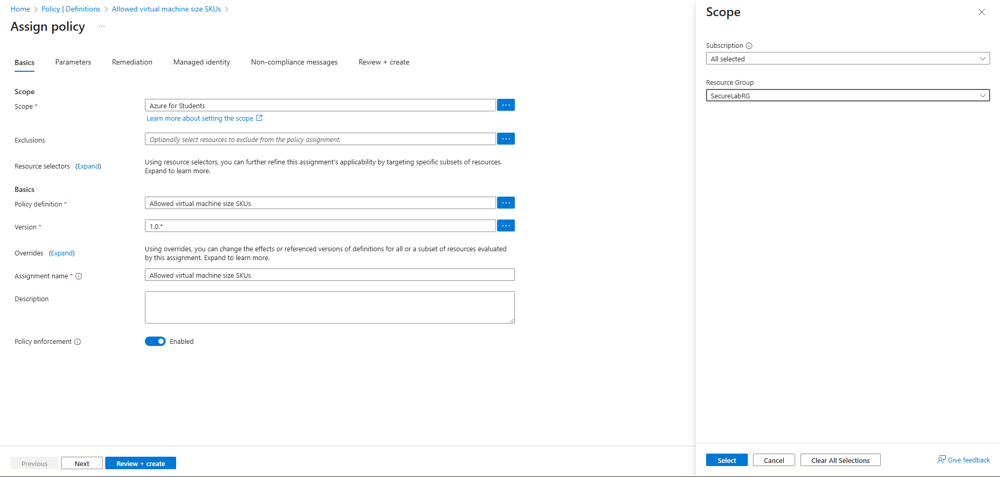 |
| **3. Defining Allowed VM SKU Parameters** | **4. Verifying Real-Time Policy Enforcement** |
| 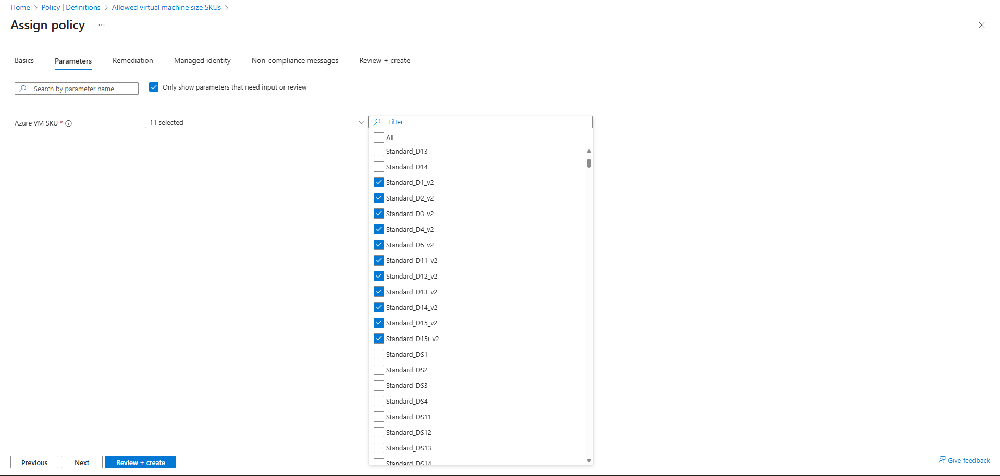 | 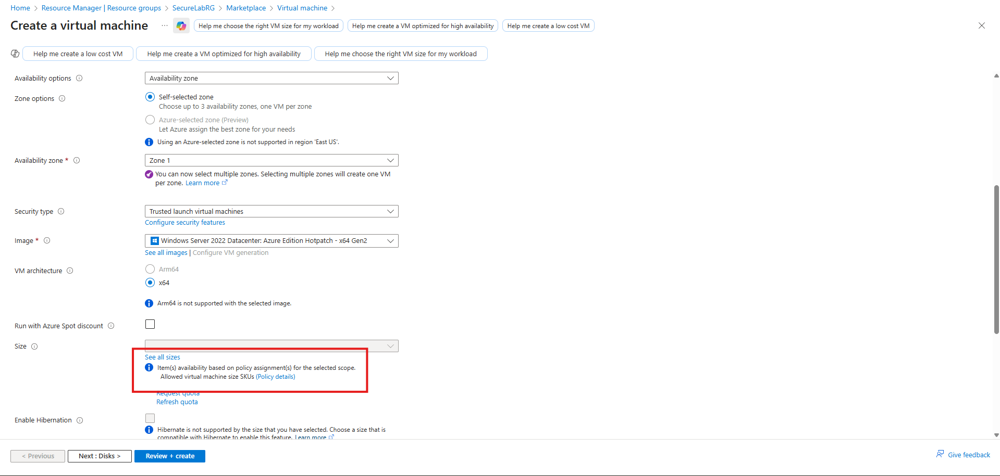 |

---

### 8. Centralized Telemetry & Diagnostic Pipeline (`SecureLabLA`)
Created a centralized **Log Analytics Workspace (`SecureLabLA`)** in `East US` and configured Diagnostic Setting **`vm1d`** to stream platform telemetry:
- **Log Category Groups:** `audit` and `allLogs`
- **Metrics:** `AllMetrics`
- **Destination:** `SecureLabLA (eastus)`

| Creating `SecureLabLA` Workspace | Configuring Diagnostic Setting `vm1d` |
| :---: | :---: |
| 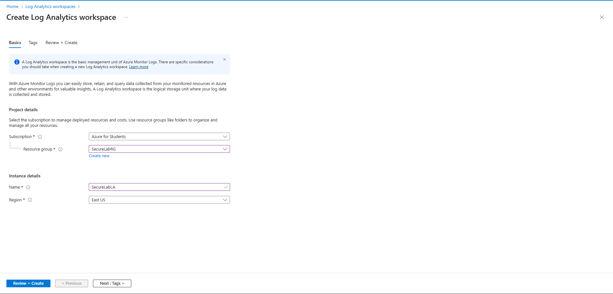 | 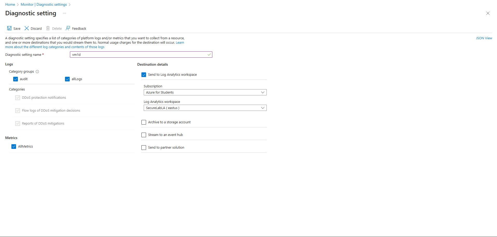 |

---

### 9. Microsoft Sentinel SIEM Onboarding
Onboarded **Microsoft Sentinel** onto the `SecureLabLA` workspace inside `SecureLabRG` (`eastus`), elevating the log repository into a full cloud-native **SIEM (Security Information and Event Management)** platform capable of KQL threat hunting, analytics rule correlation, and incident management.

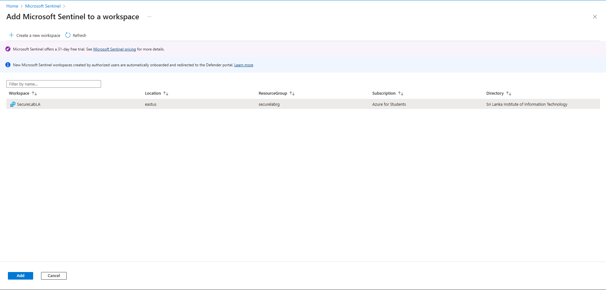

---

## 🔍 Security Investigation & KQL Hunting Queries

With Microsoft Sentinel and `SecureLabLA` ingesting control-plane (`AzureActivity`), availability (`Heartbeat`), performance (`Perf`), and host security events (`SecurityEvent`), the following **Kusto Query Language (KQL)** queries were used for security monitoring and operational verification:

### 1. Detect Failed RDP Logon Attempts (Brute-Force Hunting — Event ID `4625`)
Identifies potential brute-force attacks or unauthorized RDP login attempts against `VM1` and `VM2`, grouping failures by source IP, target account, and logon type (`LogonType == 10` for RemoteInteractive/RDP):

```kql
SecurityEvent
| where TimeGenerated > ago(24h)
| where EventID == 4625 // Account failed to log on
| where LogonType in (3, 10) // Network (3) or RemoteInteractive/RDP (10)
| summarize 
    FailedAttempts = count(),
    FirstAttempt = min(TimeGenerated),
    LastAttempt = max(TimeGenerated),
    TargetedAccounts = make_set(TargetUserName)
    by Computer, IpAddress, LogonTypeName
| where FailedAttempts >= 3
| sort by FailedAttempts desc
```

### 2. Audit Successful RDP Sessions (Event ID `4624`)
Verifies legitimate administrative sessions (such as the validation test from `175.157.141.15` to `VM1`):

```kql
SecurityEvent
| where TimeGenerated > ago(24h)
| where EventID == 4624 and LogonType == 10
| project TimeGenerated, Computer, TargetUserName, IpAddress, WorkstationName, SubjectUserName
| sort by TimeGenerated desc
```

### 3. Monitor Control-Plane RBAC & Azure Policy Modifications (`AzureActivity`)
Tracks high-privilege administrative changes across `SecureLabRG`, including NSG rule changes, RBAC role assignments, and Azure Policy modifications:

```kql
AzureActivity
| where TimeGenerated > ago(7d)
| where ResourceGroup =~ "SecureLabRG"
| where CategoryValue == "Administrative"
| where OperationNameValue has_any (
    "Microsoft.Authorization/roleAssignments/write",
    "Microsoft.Authorization/policyAssignments/write",
    "Microsoft.Network/networkSecurityGroups/securityRules/write",
    "Microsoft.Compute/virtualMachines/write"
)
| project
    TimeGenerated,
    Caller,
    CallerIpAddress,
    OperationNameValue,
    ActivityStatusValue,
    Resource,
    ResourceGroup
| sort by TimeGenerated desc
```

### 4. Verify Agent Health & Infrastructure Heartbeat
Confirms continuous telemetry ingestion and uptime across monitored endpoints in `SecureLabLA`:

```kql
Heartbeat
| where TimeGenerated > ago(24h)
| summarize LastHeartbeat = max(TimeGenerated), HeartbeatCount = count() by Computer, OSType, Version, ResourceGroup
| extend Status = iff(LastHeartbeat < ago(5m), "⚠️ Unresponsive", "✅ Healthy")
| sort by LastHeartbeat desc
```

---

## 💰 FinOps & Cloud Cost Management

Operating cloud security infrastructure responsibly requires proactive **FinOps** discipline. Throughout this project, costs were controlled via:

1. **Preventative Cost Guardrails:** Assigned Azure Policy (`Allowed virtual machine size SKUs`) to prevent accidental deployment of expensive GPU or high-memory series VMs.
2. **Right-Sized Compute & Active Deallocation:** Selected `Standard_D4s_v3` instances to ensure responsive Windows Server 2022 + Sentinel agent performance during active testing, and immediately deallocated compute instances (`Stopped (deallocated)`) when idle to halt vCPU/RAM billing.
3. **Free-Tier Telemetry Optimization:** Leveraged the Log Analytics free tier allowance (first 5 GB/month ingestion) and the **31-day Microsoft Sentinel free trial** on `SecureLabLA`.
4. **Atomic Resource Teardown:** Consolidated every dependency (VMs, Disks, NICs, Public IPs, VNet, NSG, Log Analytics Workspace) inside a single resource group (`SecureLabRG`) and executed a complete resource group deletion upon lab completion to guarantee **\$0.00 ongoing charges**.

---

## 🚀 Production Roadmap & Next-Level Enhancements

If scaling this lab architecture into an enterprise production landing zone, the following enhancements are recommended:

- [ ] **Eliminate Public IPs via Azure Bastion:** Replace direct public IP RDP access (`20.55.26.32:3389`) with **Azure Bastion** or **Defender for Cloud Just-in-Time (JIT) VM Access** for zero-standing network exposure.
- [ ] **Infrastructure as Code (IaC):** Codify the entire `SecureLabRG` stack (VNet, NSG, VMs, RBAC, Policy, Log Analytics, and Sentinel onboarding) using **Azure Bicep** or **Terraform** for repeatable CI/CD deployments.
- [ ] **Automated SOAR Playbooks:** Attach **Azure Logic Apps** playbooks to Microsoft Sentinel Analytics Rules to automatically block malicious IPs in `SecureLabNSG` when brute-force thresholds are exceeded.
- [ ] **Azure Monitor Agent (AMA) & Data Collection Rules (DCR):** Implement granular DCR filters to ingest only high-signal Windows Security Event IDs (`4624`, `4625`, `4672`, `4688`, `4720`), further optimizing SIEM ingestion costs.

---

## 👨‍💻 Author & Credentials

<div align="center">

**Nimesh Akalanka (PEIRIS K H N A)**  
🎓 *Sri Lanka Institute of Information Technology (SLIIT)*  
🏅 **Microsoft Certified: Azure Fundamentals (AZ-900)**  

[](https://github.com/nimesh895)

*Designed and documented to demonstrate practical readiness for Cloud Administration, Cloud Security Engineering, and SOC / SecOps Analyst roles.*

</div>
